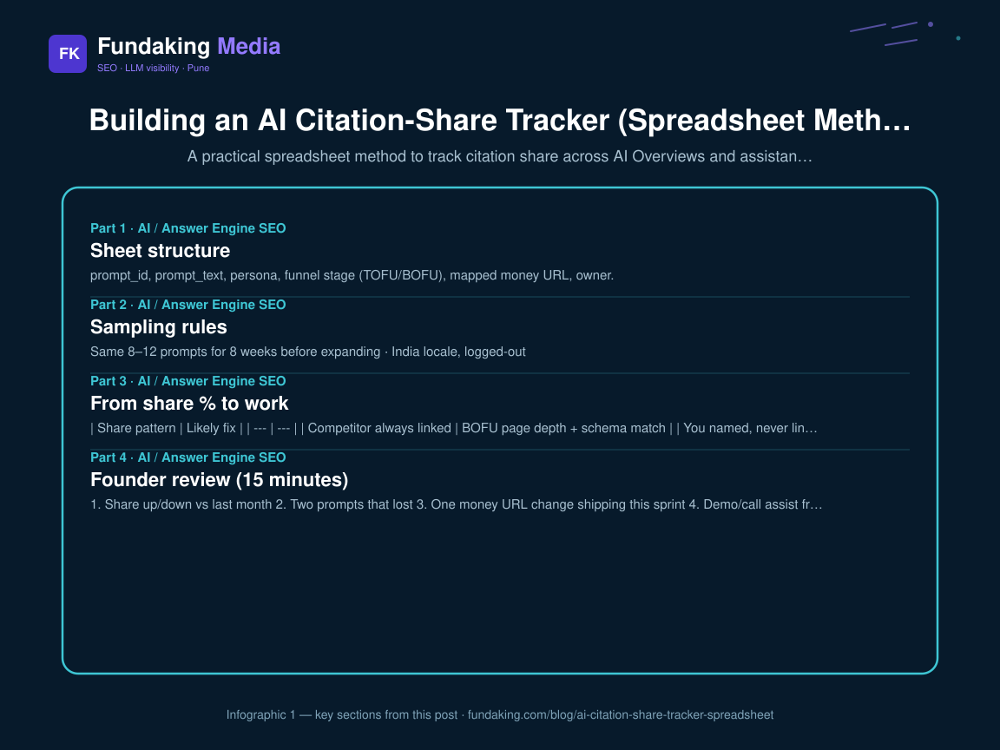
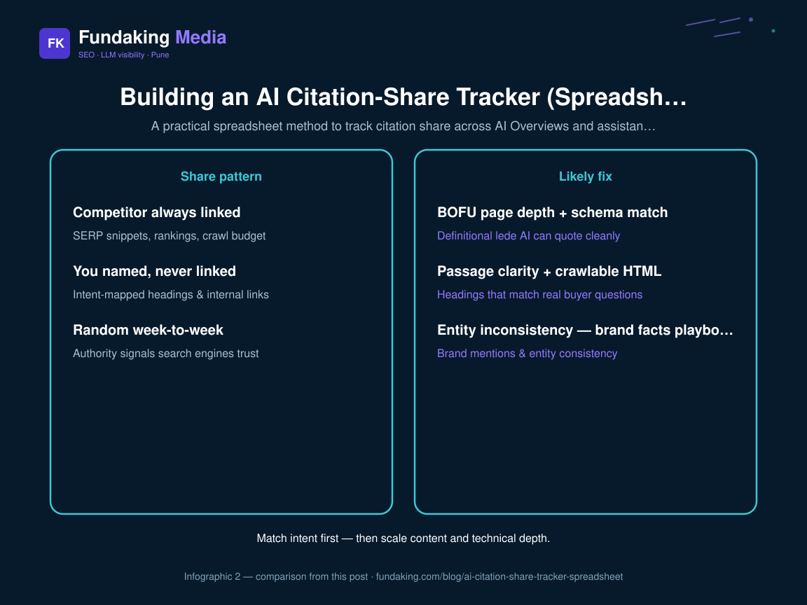

“Are we winning AI search?” is not a vibe. It is a **share of citations** across a fixed prompt set. This article gives the spreadsheet method I hand founders — sibling to [measuring AI citations without vanity tools](/blog/measuring-ai-citations-without-vanity-tools) and the hub [What is AI SEO?](/blog/what-is-ai-seo-definition-2026).

## Sheet structure

**Tab 1 — Prompt registry**  
prompt_id, prompt_text, persona, funnel stage (TOFU/BOFU), mapped money URL, owner.

**Tab 2 — Weekly captures**  
date, engine (AIO / ChatGPT / Perplexity / Gemini), locale, our_state (named/linked/absent), competitors_named (pipe-separated), sources_linked, screenshot_path, notes.

**Tab 3 — Share calc**  
For each prompt_id: count weeks named / weeks measured; same for top 3 competitors. That ratio is citation share.

**Tab 4 — Actions**  
prompt_id → defect (entity / page / technical) → ticket → due date.

## Sampling rules

- Same 8–12 prompts for 8 weeks before expanding  
- India locale, logged-out  
- Capture on a fixed weekday  
- Do not chase every new assistant weekly — rotate  

Detail protocol lives in the vanity-tools article; competitive framing in [competitor citation analysis](/blog/competitor-citation-analysis).
<figure class="blog-infographic">
  
  <figcaption><strong>Figure 1.</strong> At-a-glance summary of this article’s main sections (Fundaking infographic).</figcaption>
</figure>

<figure class="blog-infographic">
  
  <figcaption><strong>Figure 2.</strong> Side-by-side comparison pulled from the table in this post.</figcaption>
</figure>

## From share % to work

| Share pattern | Likely fix |
| --- | --- |
| Competitor always linked | BOFU page depth + schema match |
| You named, never linked | Passage clarity + crawlable HTML |
| Random week-to-week | Entity inconsistency — [brand facts playbook](/blog/fix-wrong-brand-facts-ai-hallucinations) |
| Local queries weak | GBP + local pages, not more AI blogs |

Sequence work with the [90-day AI SEO roadmap](/blog/ai-seo-roadmap-90-days).

## Founder review (15 minutes)

1. Share up/down vs last month  
2. Two prompts that lost  
3. One money URL change shipping this sprint  
4. Demo/call assist from organic landers ([measuring visibility in AI search](/blog/measuring-visibility-in-ai-search))

## FAQ

**Is Excel enough?** Yes until &gt;25 prompts and multiple brands.

**Paid tools?** Optional second opinion — never the only KPI.

**Who owns the sheet?** Marketing ops; strategist reviews monthly via [AI enablement](/ai-enablement) / AI SEO retainers. Proof: [Shubhshrey](/case-study/shubhshrey-industries).

<!-- fk-cluster-links -->

## Related reading on Fundaking

- [What Is AI SEO? A Practical Definition for 2026](/blog/what-is-ai-seo-definition-2026)
- [A 90-Day AI SEO Roadmap I Actually Hand to Founders](/blog/ai-seo-roadmap-90-days)
- [Competitor Citation Analysis in AI Search](/blog/competitor-citation-analysis)
- [Measuring AI Citations Without Vanity Tools](/blog/measuring-ai-citations-without-vanity-tools)
- [AI enablement](/ai-enablement)
- [Shubhshrey AI CRM case study](/case-study/shubhshrey-industries)

---

*Rahul Agarwal — Fundaking Media. SEO consultant based in Pune / Baramati, serving founders across India.*
