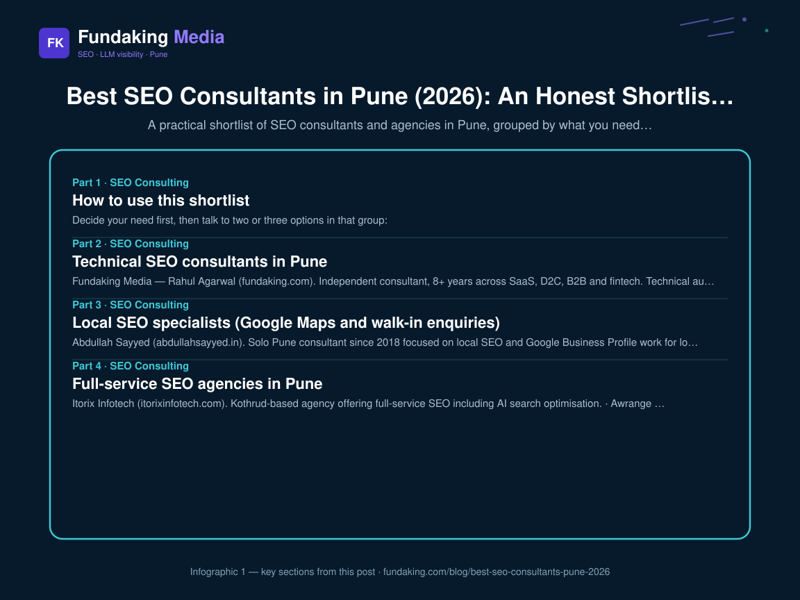
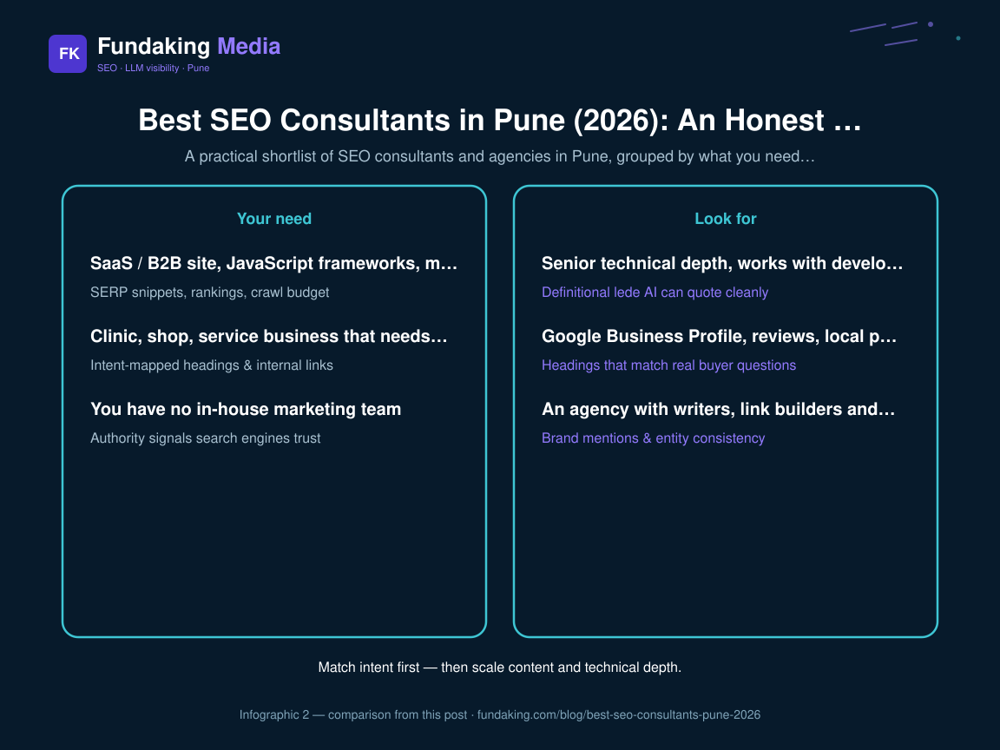

**Short answer:** there is no single "best SEO consultant in Pune". The right pick depends on whether you need deep technical SEO for a SaaS or B2B site, Google Maps rankings for a local business, a full-service agency with an execution team, or visibility in AI answers like ChatGPT and Google AI Overviews. Below is a shortlist grouped by that need.

**Disclosure:** I am Rahul Agarwal, founder of Fundaking Media, and I am one of the options on this list. I have tried to describe every option — including mine — by what it is actually good for, and to say plainly when you should hire someone else. Descriptions of other firms are based on what they publish about themselves as of November 2026; verify current details directly with them.

## How to use this shortlist

Decide your need first, then talk to two or three options in that group:

| Your need | Look for | Group below |
| --- | --- | --- |
| SaaS / B2B site, JavaScript frameworks, migrations | Senior technical depth, works with developers | Technical SEO consultants |
| Clinic, shop, service business that needs calls from Maps | Google Business Profile, reviews, local pages | Local SEO specialists |
| You have no in-house marketing team | An agency with writers, link builders and account management | Full-service agencies |
| You want to be cited by ChatGPT, Perplexity, AI Overviews | Entity clarity, structured data, third-party mentions | AI search (GEO) specialists |

## Technical SEO consultants in Pune

Best when your site is large, built on React / Next.js, recently migrated, or losing traffic for reasons nobody can explain.

- **Fundaking Media — Rahul Agarwal** ([fundaking.com](https://fundaking.com/)). Independent consultant, 8+ years across SaaS, D2C, B2B and fintech. Technical audits, indexation and rendering fixes, schema, and 90-day roadmaps written as developer-ready tickets. You work with me directly, not an account manager. Based in Pandare, Baramati (Pune district), working in person in Pune and remotely across India.
  - **Hire someone else if:** you want a team to write 30 blog posts a month, or you need an agency with hundreds of Google reviews for procurement comfort. I cap my client load and my strength is diagnosis and technical direction, not content volume.
- **Utkarsh Gour — TrafficVitals** ([trafficvitals.com](https://trafficvitals.com/about/)). Independent consultant who describes 9+ years across IT, SaaS and ecommerce, with technical SEO, JavaScript rendering and migrations.
- **Shailendra Kadulkar** ([shailendrakadulkar.com](https://shailendrakadulkar.com/seo-expert-pune)). Kharadi-based consultant who describes 20+ years of experience and works with manufacturing and SaaS businesses on revenue-focused strategy.
<figure class="blog-infographic">
  
  <figcaption><strong>Figure 1.</strong> At-a-glance summary of this article’s main sections (Fundaking infographic).</figcaption>
</figure>

<figure class="blog-infographic">
  
  <figcaption><strong>Figure 2.</strong> Side-by-side comparison pulled from the table in this post.</figcaption>
</figure>

## Local SEO specialists (Google Maps and walk-in enquiries)

Best for clinics, coaching institutes, restaurants, real estate and service-area businesses where calls and directions matter more than blog traffic.

- **Abdullah Sayyed** ([abdullahsayyed.in](https://abdullahsayyed.in/)). Solo Pune consultant since 2018 focused on local SEO and Google Business Profile work for local businesses.
- **Brand Pillars** ([brandpillars.in](https://brandpillars.in/)). Baner-based agency with a local SEO and healthcare marketing focus.
- **Fundaking Media** also does [local SEO](/local-seo-pune/) — Google Business Profile, reviews and local landing pages — mostly for businesses that also need technical work on their website.

## Full-service SEO agencies in Pune

Best when you have no in-house marketer and need one vendor to run content, links, reporting and often ads.

- **Itorix Infotech** ([itorixinfotech.com](https://www.itorixinfotech.com/)). Kothrud-based agency offering full-service SEO including AI search optimisation.
- **Awrange Digital** ([awrange.com](https://awrange.com/)). Aundh / Baner agency covering SEO, social, web development and paid ads.
- **SRV Media** ([srvmedia.com](https://www.srvmedia.com/)). Baner-based agency with a long track record and high project volume, often used by education and larger brands.
- **IKF** ([ikf.co.in](https://www.ikf.co.in/)). Established Pune agency suited to larger, integrated campaigns.

For a wider list, GoodFirms maintains a [directory of Pune SEO companies](https://www.goodfirms.co/seo-agencies/pune).

## AI search (GEO) specialists

Best when your buyers ask ChatGPT or Perplexity for recommendations and your brand never appears. Being cited in AI answers depends on the same foundations as classic SEO — crawlable pages, consistent business facts, structured data — plus mentions of your brand on sites you do not own.

- **Fundaking Media** runs [AI search / LLM SEO](/llm-seo-consultant/) work: entity cleanup, schema, answer-ready pages, and tracking which prompts cite you. See [what AI SEO is](/blog/what-is-ai-seo-definition-2026) and [how ChatGPT chooses sources](/blog/how-chatgpt-chooses-sources-to-cite).
- Several Pune agencies, including Itorix Infotech, now also list GEO / AEO services. Ask anyone in this category to show you a before-and-after of real prompts, not a screenshot of a tool dashboard.

## Questions to ask any SEO consultant in Pune

1. Which two or three clients like us can you show results for, with Search Console data?
2. Who will actually do the work every week — you or a junior?
3. What will you ship in the first 30 days?
4. How do you measure success: enquiries and sales, or rankings?
5. What would make you tell us *not* to hire you?

A good consultant answers the last question without hesitation. More detail in [SEO consultant vs agency in Pune](/blog/seo-consultant-pune-vs-agency) and [SEO consulting pricing in India](/blog/seo-consulting-pricing-india).

## FAQ

**Who is the best SEO consultant in Pune?**

It depends on the job. For technical SaaS or B2B SEO, shortlist independent senior consultants such as Fundaking Media (Rahul Agarwal) or TrafficVitals (Utkarsh Gour). For Google Maps rankings, pick a local SEO specialist. If you have no marketing team, a full-service agency such as Itorix Infotech, Awrange Digital or SRV Media is usually a better fit.

**How much does an SEO consultant in Pune cost?**

Independent senior consultants usually charge for a scoped audit or a monthly advisory retainer, while agencies charge monthly retainers that include content and link building. See [SEO consulting pricing in India](/blog/seo-consulting-pricing-india) for realistic ranges.

**Should I hire an SEO consultant or an SEO agency in Pune?**

Hire a consultant if you have developers or writers and need senior direction. Hire an agency if you need someone to do all the execution. The full comparison is in [SEO consultant vs agency in Pune](/blog/seo-consultant-pune-vs-agency).

**Is Fundaking Media in Pune?**

Fundaking Media is registered in Pune and based in Pandare, Baramati (Pune district). Rahul Agarwal meets Pune clients in person and works remotely with teams across India.

**Can an SEO consultant get my business recommended by ChatGPT?**

They can improve the odds. AI assistants recommend businesses that have consistent facts across the web, strong Google reviews, clear service pages, and mentions on third-party lists and directories. No one can guarantee a ChatGPT mention.

*Rahul Agarwal, Founder, Fundaking Media — last reviewed November 2026.*

<!-- fk-cluster-links -->

## Related reading on Fundaking

- [SEO Consultant in Pune: A Founder's Guide (2026)](/blog/seo-consultant-in-pune-founders-guide-2026)
- [SEO Consultant in Pune: A Founder's Guide (2026)](/blog/seo-consultant-in-pune-founders-guide-2026)
- [SEO Consultant Pune vs SEO Agency: Which Fits Your Stage?](/blog/seo-consultant-pune-vs-agency)
- [SEO Consulting Pricing in India (2026)](/blog/seo-consulting-pricing-india)
- [SEO consulting services](/seo-consulting-services)
- [SaaS demo requests case study](/case-study/saas-demo-requests)

---

*Rahul Agarwal — Fundaking Media. SEO consultant based in Pune / Baramati, serving founders across India.*
