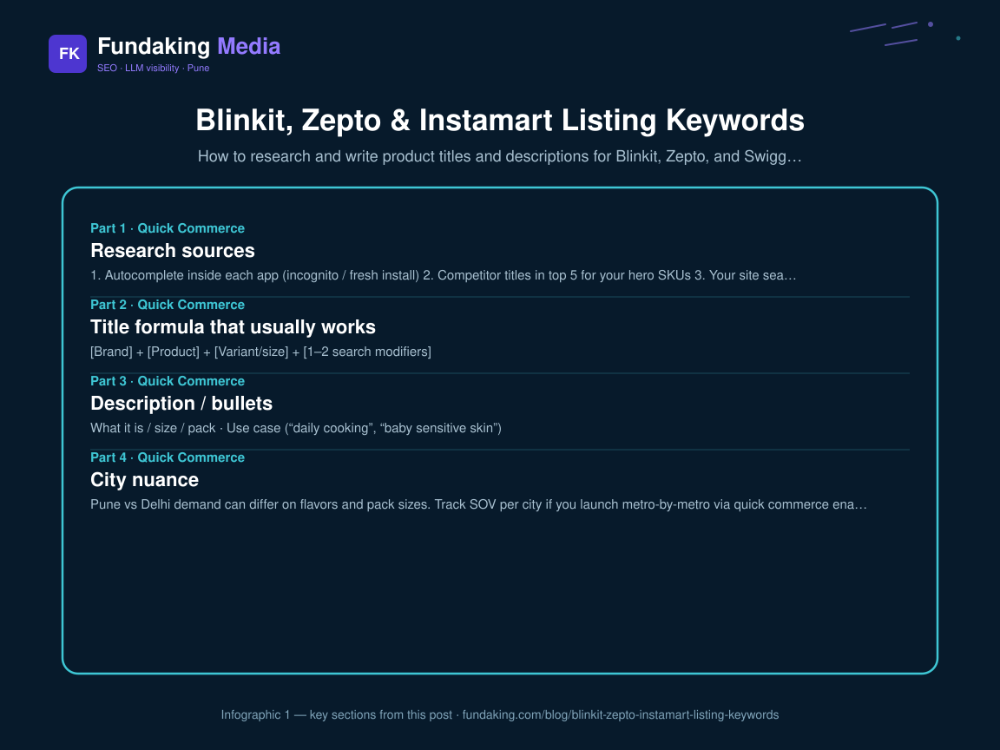
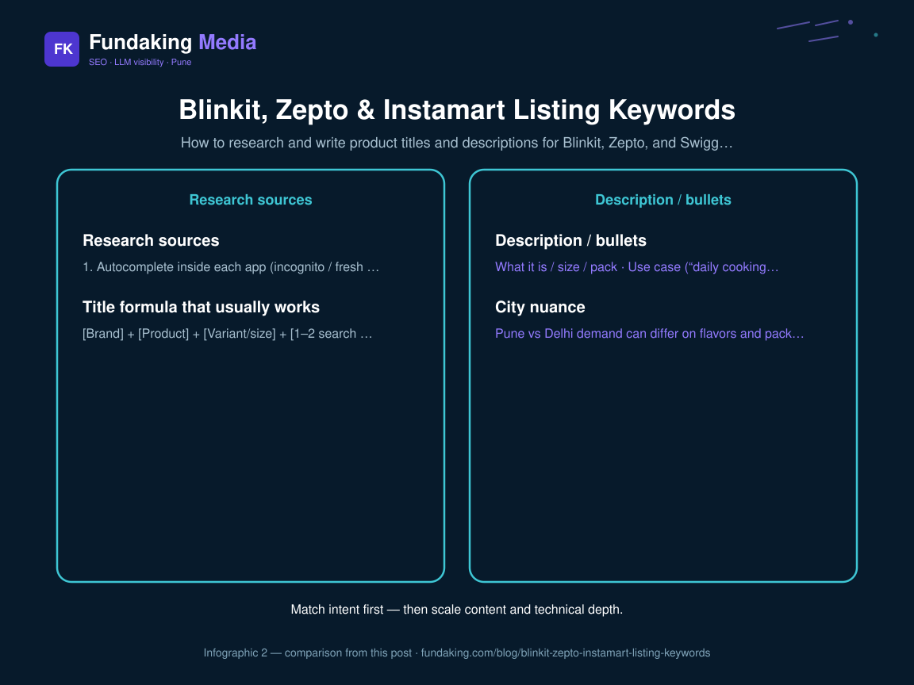

In-app search is literal. If the shopper types “cold pressed oil” and your title says “artisanal wellness elixir,” you lose. This spoke deepens the [quick commerce visibility playbook](/blog/quick-commerce-seo-visibility-playbook-india).

## Research sources

1. Autocomplete inside each app (incognito / fresh install)  
2. Competitor titles in top 5 for your hero SKUs  
3. Your site search / Shopify search logs  
4. Support chats (“do you have X?”)

Build a sheet: search_term → volume proxy (rank of competitor) → preferred title token → banned fluff words.

## Title formula that usually works

`[Brand] + [Product] + [Variant/size] + [1–2 search modifiers]`

Example: `FarmGold Groundnut Oil 1L Cold Pressed` — not a poem.

Keep platform character limits. Put the highest-intent modifier early. Pair with [catalogue content ops](/blog/quick-commerce-catalogue-content-ops) so variants do not cannibalize each other.
<figure class="blog-infographic">
  
  <figcaption><strong>Figure 1.</strong> At-a-glance summary of this article’s main sections (Fundaking infographic).</figcaption>
</figure>

<figure class="blog-infographic">
  
  <figcaption><strong>Figure 2.</strong> Implementation checklist vs measurement focus — from this article.</figcaption>
</figure>

## Description / bullets

- What it is / size / pack  
- Use case (“daily cooking”, “baby sensitive skin”)  
- Differentiator with proof  
- Storage / FSSAI where relevant  

No keyword stuffing paragraphs. Apps and AI shopping surfaces prefer scannable facts — see [product data feeds](/blog/product-data-feeds-and-ai-shopping).

## City nuance

Pune vs Delhi demand can differ on flavors and pack sizes. Track SOV per city if you launch metro-by-metro via [quick commerce enablement](/quick-commerce-enablement).

## FAQ

**Same title on all three apps?** Same core tokens; tweak to each platform’s length and category taxonomy.

**Hindi terms?** Where shoppers type Hinglish (“sabun”, “atta”), include those tokens naturally.

<!-- fk-cluster-links -->

## Related reading on Fundaking

- [Quick Commerce SEO & Visibility Playbook (India)](/blog/quick-commerce-seo-visibility-playbook-india)
- [Quick Commerce Catalogue Content Ops](/blog/quick-commerce-catalogue-content-ops)
- [Quick Commerce SEO & Visibility Playbook (India)](/blog/quick-commerce-seo-visibility-playbook-india)
- [SEO for D2C Brands in India (Shopify & Beyond)](/blog/seo-for-d2c-brands-india)
- [Quick commerce enablement](/quick-commerce-enablement)
- [Quick commerce listing audit call](/contact)

---

*Rahul Agarwal — Fundaking Media. SEO consultant based in Pune / Baramati, serving founders across India.*
