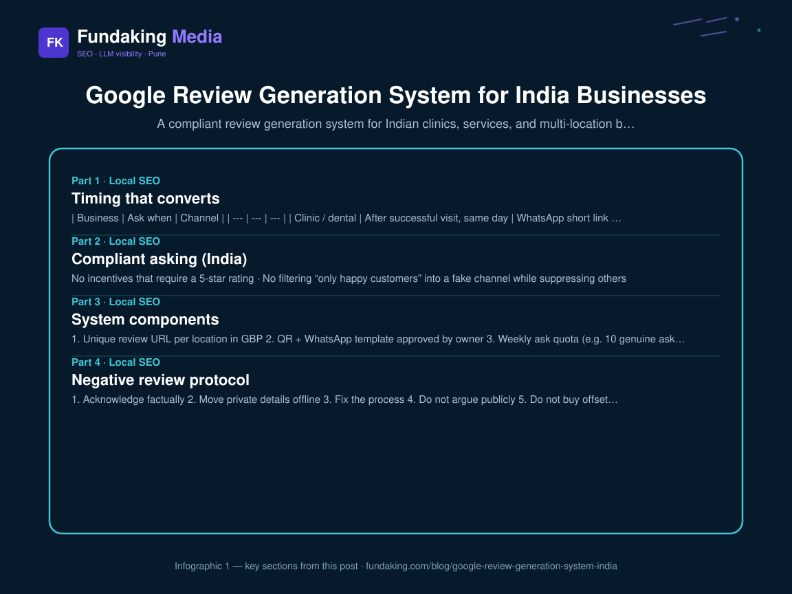
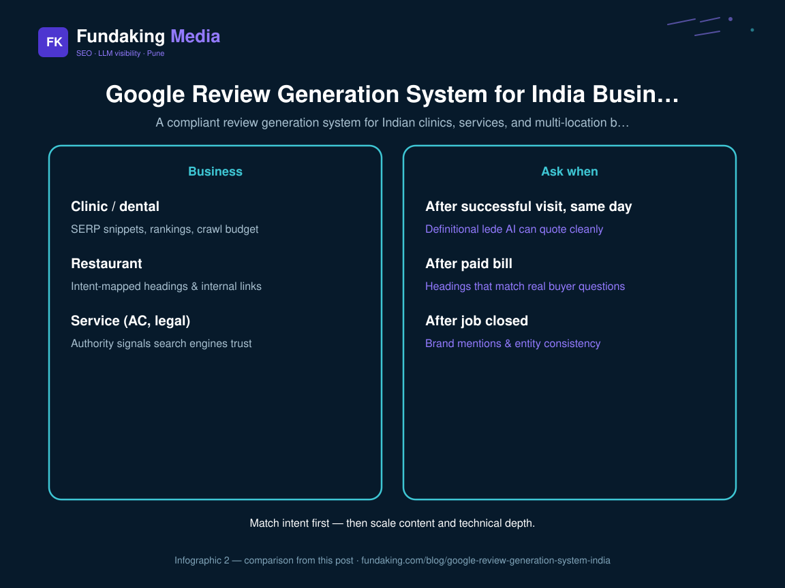

Reviews are still the prominence lever most Indian local businesses under-operate. Not “buy reviews” — **ask at the right moment, make it frictionless, respond like a human**. This spoke belongs under the [local SEO India playbook](/blog/local-seo-india-playbook).

## Timing that converts

| Business | Ask when | Channel |
| --- | --- | --- |
| Clinic / dental | After successful visit, same day | WhatsApp short link |
| Restaurant | After paid bill | QR on table / bill |
| Service (AC, legal) | After job closed | SMS / WhatsApp |
| Multi-location retail | At POS | Staff + QR |

Never ask only unhappy customers by accident (complaint desk only). Train front-line staff with a one-line script.

## Compliant asking (India)

- No incentives that require a 5-star rating  
- No filtering “only happy customers” into a fake channel while suppressing others  
- Use the official Google review link / QR from GBP  
- Keep NAP consistent so reviews attach to the right entity ([NAP consistency](/blog/nap-consistency-india-directories))
<figure class="blog-infographic">
  
  <figcaption><strong>Figure 1.</strong> At-a-glance summary of this article’s main sections (Fundaking infographic).</figcaption>
</figure>

<figure class="blog-infographic">
  
  <figcaption><strong>Figure 2.</strong> Side-by-side comparison pulled from the table in this post.</figcaption>
</figure>

## System components

1. **Unique review URL** per location in GBP  
2. **QR + WhatsApp template** approved by owner  
3. **Weekly ask quota** (e.g. 10 genuine asks)  
4. **Response SLA** — 48 hours for negatives, 72 for positives  
5. **Theme log** — map complaints to ops fixes, not only SEO vanity  

Pair with [GBP optimization India](/blog/google-business-profile-optimization-india) and [WhatsApp leads from Maps](/blog/whatsapp-leads-from-google-maps-india).

## Negative review protocol

1. Acknowledge factually  
2. Move private details offline  
3. Fix the process  
4. Do not argue publicly  
5. Do not buy offsetting fake reviews  

## Clinics note

For clinics, reviews often mention doctor names — keep faculty pages and GBP categories aligned. See [local SEO for clinics India](/blog/local-seo-for-clinics-india).

## FAQ

**How fast do ratings move?** Velocity and recency matter more than dumping 50 old reviews once.

**Same system for chains?** Yes — per-location links, never one global QR. [Multi-location local SEO](/blog/multi-location-local-seo-india).

**Who runs this?** Ops + front desk; SEO sets the system via [local SEO consulting](/local-seo-consultant). Proof: [Real Group](/case-study/real-group).

<!-- fk-cluster-links -->

## Related reading on Fundaking

- [Local SEO India Playbook: Maps, GBP, and Organic](/blog/local-seo-india-playbook)
- [GBP Q&A and Messaging That Converts](/blog/gbp-qa-messaging-that-converts)
- [Google Business Profile Optimization for India](/blog/google-business-profile-optimization-india)
- [Google Business Profile Posts Strategy](/blog/google-business-profile-posts-strategy)
- [Local SEO consulting](/local-seo-consultant)
- [Real Group case study](/case-study/real-group)

---

*Rahul Agarwal — Fundaking Media. SEO consultant based in Pune / Baramati, serving founders across India.*
