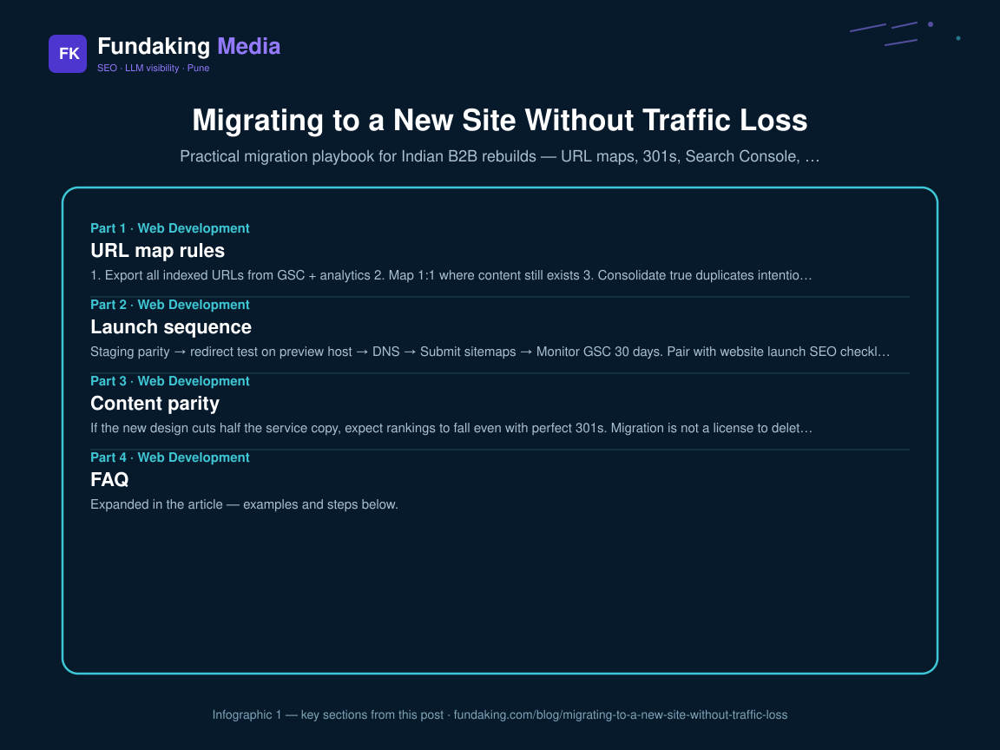
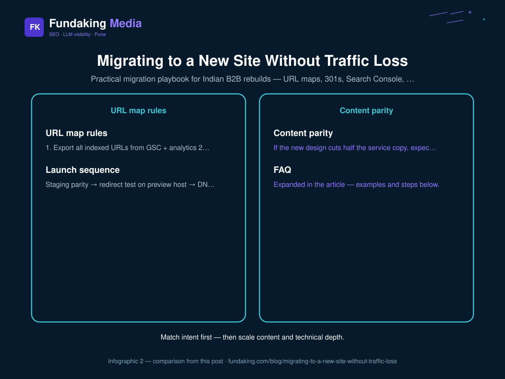

Rebuilds destroy rankings when URL maps are improvised on launch night. This spoke is the Web Dev cluster view; the deep technical checklist is [site migration SEO checklist](/blog/site-migration-seo-checklist). Hub: [SEO-ready builds](/blog/seo-ready-website-builds-indian-b2b).

## URL map rules

1. Export all indexed URLs from GSC + analytics  
2. Map 1:1 where content still exists  
3. Consolidate true duplicates intentionally  
4. Never soft-404 money URLs  
5. Keep chains short ([HTTPS redirect chains](/blog/https-redirect-chains-seo-fix))

## Launch sequence

Staging parity → redirect test on preview host → DNS → Submit sitemaps → Monitor GSC 30 days. Pair with [website launch SEO checklist](/blog/website-launch-seo-checklist-india).
<figure class="blog-infographic">
  
  <figcaption><strong>Figure 1.</strong> At-a-glance summary of this article’s main sections (Fundaking infographic).</figcaption>
</figure>

<figure class="blog-infographic">
  
  <figcaption><strong>Figure 2.</strong> Implementation checklist vs measurement focus — from this article.</figcaption>
</figure>

## Content parity

If the new design cuts half the service copy, expect rankings to fall even with perfect 301s. Migration is not a license to delete proof.

## FAQ

**WordPress to Next.js?** Doable — rendering and redirects are the risk, not the brand.

**Who owns it?** [Web development](/web-development) + [technical SEO](/technical-seo-consultant) jointly.

<!-- fk-cluster-links -->

## Related reading on Fundaking

- [SEO-Ready Website Builds for Indian B2B](/blog/seo-ready-website-builds-indian-b2b)
- [HTTPS and Redirect Chains: SEO Fix Guide](/blog/https-redirect-chains-seo-fix)
- [SEO-Ready Website Builds for Indian B2B](/blog/seo-ready-website-builds-indian-b2b)
- [Site Migration SEO Checklist](/blog/site-migration-seo-checklist)
- [Web development services](/web-development)
- [Shubhshrey website and CRM case study](/case-study/shubhshrey-industries)

---

*Rahul Agarwal — Fundaking Media. SEO consultant based in Pune / Baramati, serving founders across India.*
