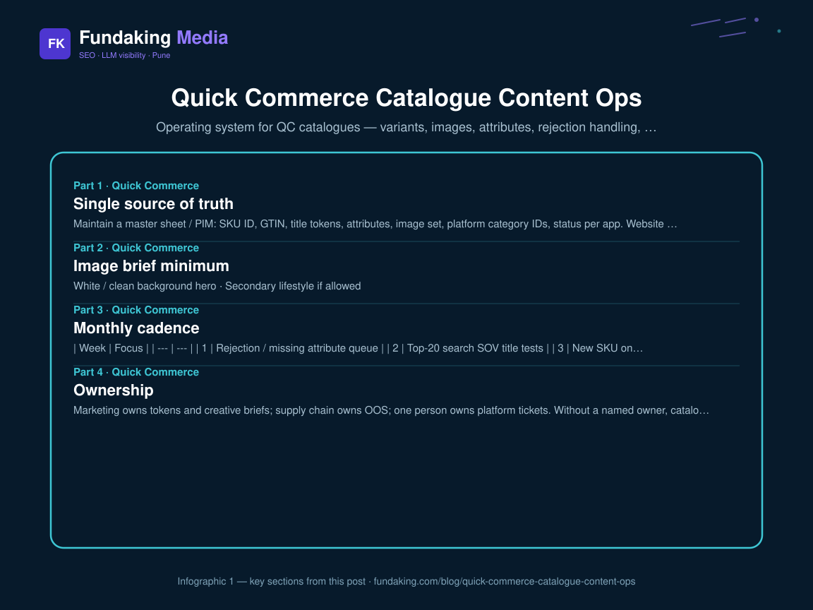
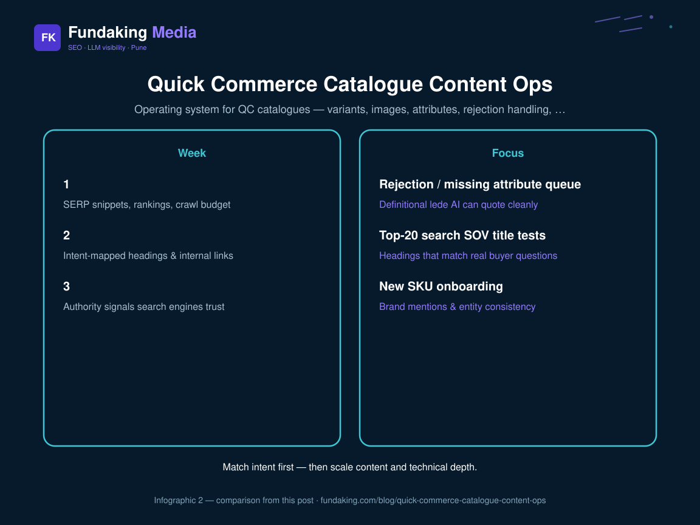

Keyword research dies without ops. Brands that “optimise titles once” then let distributors upload junk lose visibility in weeks. Hub: [QC SEO playbook](/blog/quick-commerce-seo-visibility-playbook-india).

## Single source of truth

Maintain a master sheet / PIM: SKU ID, GTIN, title tokens, attributes, image set, platform category IDs, status per app. Website Shopify data should sync — [Shopify technical SEO](/blog/shopify-technical-seo-checklist) keeps the owned site clean while QC apps stay consistent.

## Image brief minimum

- White / clean background hero  
- Secondary lifestyle if allowed  
- Size / pack readable  
- No banned claims on image text
<figure class="blog-infographic">
  
  <figcaption><strong>Figure 1.</strong> At-a-glance summary of this article’s main sections (Fundaking infographic).</figcaption>
</figure>

<figure class="blog-infographic">
  
  <figcaption><strong>Figure 2.</strong> Side-by-side comparison pulled from the table in this post.</figcaption>
</figure>

## Monthly cadence

| Week | Focus |
| --- | --- |
| 1 | Rejection / missing attribute queue |
| 2 | Top-20 search SOV title tests |
| 3 | New SKU onboarding |
| 4 | Rating / OOS review with ops |

## Ownership

Marketing owns tokens and creative briefs; supply chain owns OOS; one person owns platform tickets. Without a named owner, catalogues rot.

## FAQ

**Distributor uploads?** Give them a locked template or you will re-fix forever.

**Need help?** [Quick commerce enablement](/quick-commerce-enablement) or [contact](/contact).

<!-- fk-cluster-links -->

## Related reading on Fundaking

- [Quick Commerce SEO & Visibility Playbook (India)](/blog/quick-commerce-seo-visibility-playbook-india)
- [Blinkit, Zepto & Instamart Listing Keywords](/blog/blinkit-zepto-instamart-listing-keywords)
- [Quick Commerce SEO & Visibility Playbook (India)](/blog/quick-commerce-seo-visibility-playbook-india)
- [Shopify Technical SEO Checklist](/blog/shopify-technical-seo-checklist)
- [Quick commerce enablement](/quick-commerce-enablement)
- [Quick commerce listing audit call](/contact)

---

*Rahul Agarwal — Fundaking Media. SEO consultant based in Pune / Baramati, serving founders across India.*
