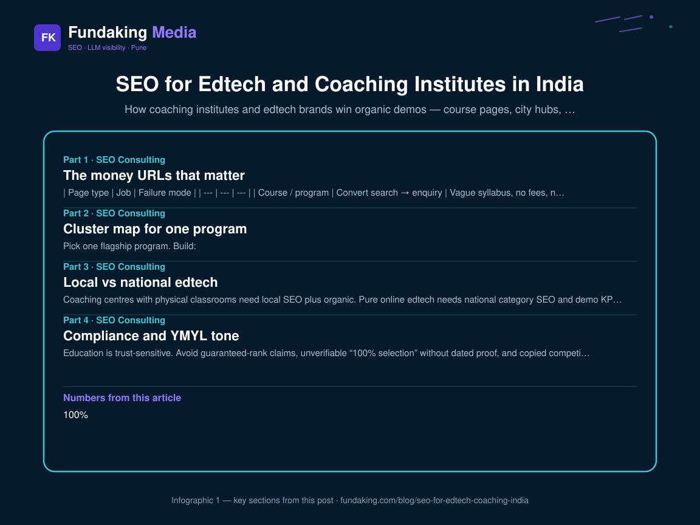
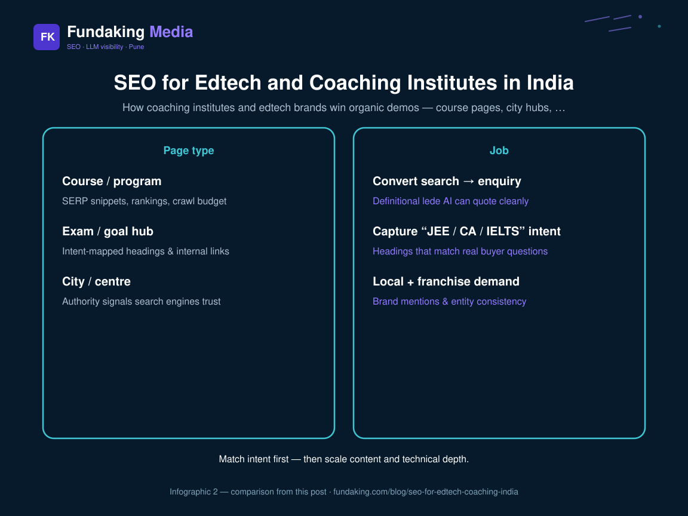

Indian coaching and edtech sites usually fail SEO the same way: a homepage promise, a thin “courses” dump, and blog posts that never touch the money URLs. Parents and working professionals search for outcomes — exam names, batch cities, fee clarity, faculty proof — not “innovative learning ecosystem.”

This spoke sits under the [SEO consultant in Pune founder’s guide](/blog/seo-consultant-in-pune-founders-guide-2026). Pair it with [content cluster strategy for B2B India](/blog/content-cluster-strategy-b2b-india) when you need the architecture, not more articles.

## The money URLs that matter

| Page type | Job | Failure mode |
| --- | --- | --- |
| Course / program | Convert search → enquiry | Vague syllabus, no fees, no next batch |
| Exam / goal hub | Capture “JEE / CA / IELTS” intent | Thin doorway pages |
| City / centre | Local + franchise demand | Duplicate NAP, fake addresses |
| Comparison / vs | Steal mid-funnel | Sales fluff without table |
| Faculty / results | Trust | Unverifiable claims |

If those five templates are weak, publishing “10 tips for students” will not create topical authority.

## Cluster map for one program

Pick **one** flagship program. Build:

1. Program page (BOFU) with fees band, eligibility, duration, CTA  
2. Two supporting explainers (syllabus depth, who it is for)  
3. One comparison (vs competitor or vs self-study)  
4. FAQ block that matches sales objections  
5. Internal links from blog → program → contact / WhatsApp  

Then expand to the next program. Volume without this spine dilutes crawl and trust.
<figure class="blog-infographic">
  
  <figcaption><strong>Figure 1.</strong> At-a-glance summary of this article’s main sections (Fundaking infographic).</figcaption>
</figure>

<figure class="blog-infographic">
  
  <figcaption><strong>Figure 2.</strong> Side-by-side comparison pulled from the table in this post.</figcaption>
</figure>

## Local vs national edtech

Coaching centres with physical classrooms need [local SEO](/blog/local-seo-india-playbook) plus organic. Pure online edtech needs national category SEO and demo KPIs — see [SEO roadmap for SaaS founders](/blog/seo-roadmap-for-saas-founders-india). Do not force Maps strategies onto a pan-India LMS.

## Compliance and YMYL tone

Education is trust-sensitive. Avoid guaranteed-rank claims, unverifiable “100% selection” without dated proof, and copied competitor faculty bios. Align About, Organization schema, and course pages. Assistants punish contradiction faster than Google alone.

## 30-day sprint

**Week 1:** Inventory programs; pick one money URL; fix indexation and title.  
**Week 2:** Rewrite program page + FAQ; add comparison table.  
**Week 3:** Wire three existing posts to that URL; add GBP if you have a centre.  
**Week 4:** Measure enquiries / demo form completes — not only rankings.

## FAQ

**Do we need a blog?** Only after money URLs convert. Blogs support hubs; they are not the product.

**City pages for every centre?** Yes if NAP is real and unique. No if they are spun templates.

**What should we hire for?** Strategy + technical floor + program-page copy — via [SEO consulting](/seo-consulting-services). Proof pattern: [SaaS demo requests case study](/case-study/saas-demo-requests).

<!-- fk-cluster-links -->

## Related reading on Fundaking

- [SEO Consultant in Pune: A Founder's Guide (2026)](/blog/seo-consultant-in-pune-founders-guide-2026)
- [Content Cluster Strategy for B2B in India](/blog/content-cluster-strategy-b2b-india)
- [SEO Consultant in Pune: A Founder's Guide (2026)](/blog/seo-consultant-in-pune-founders-guide-2026)
- [SEO for Funded Startups in India (Post-PMF)](/blog/seo-for-funded-startups-india)
- [SEO consulting services](/seo-consulting-services)
- [SaaS demo requests case study](/case-study/saas-demo-requests)

---

*Rahul Agarwal — Fundaking Media. SEO consultant based in Pune / Baramati, serving founders across India.*
