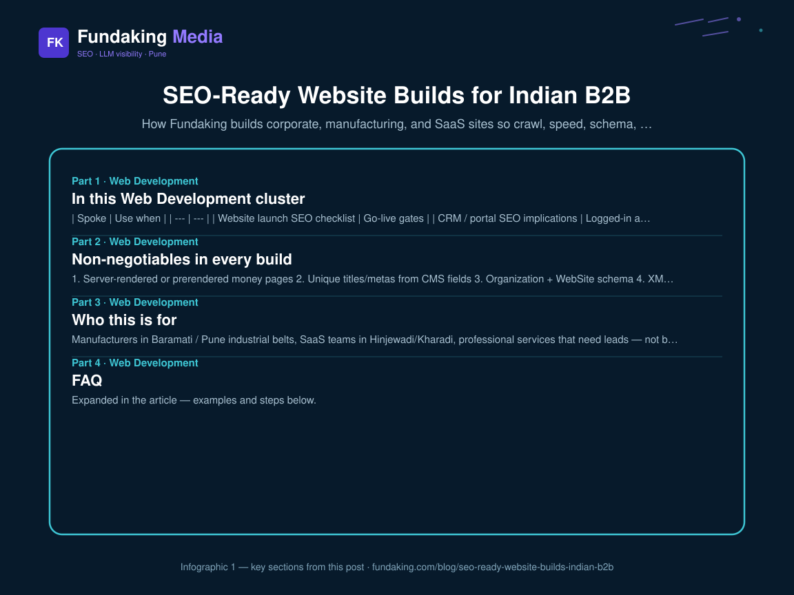
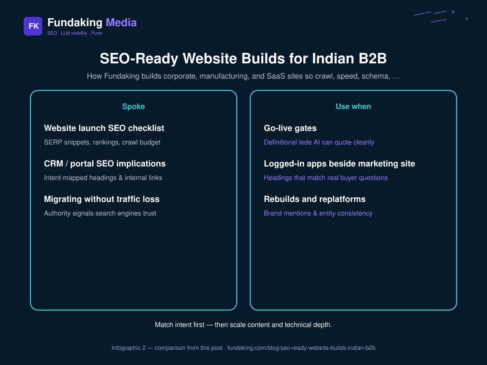

Pretty sites that fail Search Console are expensive brochures. Because we also run SEO engagements, every Fundaking build ships with crawlable HTML, sane URLs, schema, analytics, and a path to enquiry. This is the **hub** for the Web Development × SEO cluster.

## In this Web Development cluster

| Spoke | Use when |
| --- | --- |
| [Website launch SEO checklist](/blog/website-launch-seo-checklist-india) | Go-live gates |
| [CRM / portal SEO implications](/blog/crm-portal-seo-implications) | Logged-in apps beside marketing site |
| [Migrating without traffic loss](/blog/migrating-to-a-new-site-without-traffic-loss) | Rebuilds and replatforms |

Service: [Web development](/web-development). Technical depth: [technical SEO audit checklist](/blog/technical-seo-audit-checklist-2026). Stack notes: [Next.js SEO rendering](/blog/nextjs-seo-rendering-guide). Proof: [Shubhshrey website & CRM](/case-study/shubhshrey-industries).

**Ready to build?** Start with [SEO-ready web development](/web-development/) for corporate sites, CRMs and portals that ship crawlable and fast on day one.

## Non-negotiables in every build

1. Server-rendered or prerendered money pages  
2. Unique titles/metas from CMS fields  
3. Organization + WebSite schema  
4. XML sitemap + robots  
5. Core Web Vitals budget  
6. 404 / redirect plan  
7. Enquiry CTA above the fold on service pages
<figure class="blog-infographic">
  
  <figcaption><strong>Figure 1.</strong> At-a-glance summary of this article’s main sections (Fundaking infographic).</figcaption>
</figure>

<figure class="blog-infographic">
  
  <figcaption><strong>Figure 2.</strong> Side-by-side comparison pulled from the table in this post.</figcaption>
</figure>

## Who this is for

Manufacturers in Baramati / Pune industrial belts, SaaS teams in Hinjewadi/Kharadi, professional services that need leads — not brochure WordPress themes with five page builders fighting each other.

## FAQ

**Already have a site?** Start with [technical SEO consulting](/technical-seo-consultant), not a vanity redesign.

**Need both site + CRM?** Same engagement model as Shubhshrey — public site + internal follow-up.

<!-- fk-cluster-links -->

## Related reading on Fundaking

- [CRM and Portal SEO Implications](/blog/crm-portal-seo-implications)
- [Migrating to a New Site Without Traffic Loss](/blog/migrating-to-a-new-site-without-traffic-loss)
- [Next.js SEO: Rendering Guide for Marketing Sites](/blog/nextjs-seo-rendering-guide)
- [Web development services](/web-development)
- [Shubhshrey website and CRM case study](/case-study/shubhshrey-industries)

---

*Rahul Agarwal — Fundaking Media. SEO consultant based in Pune / Baramati, serving founders across India.*
